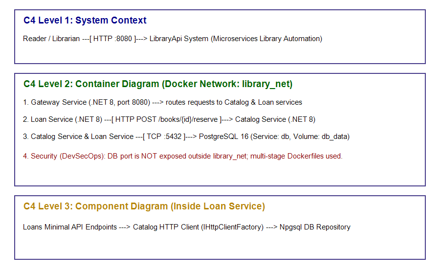

# LibraryApi — икросервисная система автоматизации библиотеки

инальный проект по дисциплине **«ведение в DevSecOps»**.

## рхитектура системы (C4 Model)
- сходник схемы (draw.io): [docs/architecture.drawio](docs/architecture.drawio)


### еализованные сервисы и взаимодействие
1. **gateway-service** (порт `8080`) — единая точка входа (API Gateway).
2. **catalog-service** — управление каталогом книг и статусом доступности в PostgreSQL.
3. **loan-service** — оформление выдачи книг; при создании выдачи синхронно вызывает `POST /books/{id}/reserve` у `catalog-service` по HTTP.
4. **db** (`postgres:16`) — база данных PostgreSQL с сохранением данных в именованном томе `db_data` внутри сети `library_net`.

## нструкция по запуску с нуля
```bash
docker compose up -d --build
docker compose ps
```

## роверка API и сохранения данных в PostgreSQL
```bash
curl -X POST http://localhost:8080/api/books -H "Content-Type: application/json" -d '{"title":"DevSecOps Handbook","author":"Gene Kim"}'
curl http://localhost:8080/api/books
curl -X POST http://localhost:8080/api/loans -H "Content-Type: application/json" -d '{"bookId":1,"readerName":"Ivan Ivanov"}'
curl http://localhost:8080/api/books
docker compose restart
curl http://localhost:8080/api/loans
```


